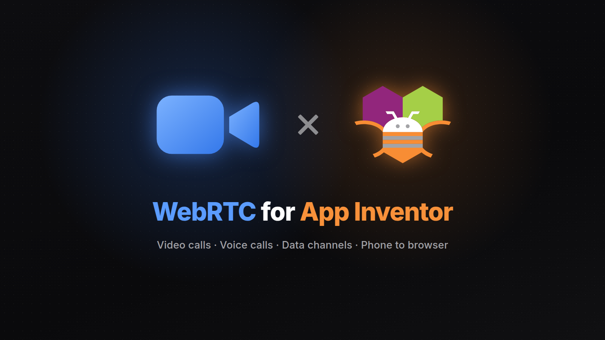

<p align="center">
  
</p>

<p align="center">
  <a href="https://github.com/zainulhassan815/webrtc-appinventor/releases/latest"></a>
  <a href="LICENSE"></a>
  
  
</p>

<p align="center">
  <a href="https://github.com/zainulhassan815/webrtc-appinventor/releases/latest">Download</a> ·
  <a href="docs/blocks.md">Blocks</a> ·
  <a href="docs/sample.md">Sample</a> ·
  <a href="samples/web-call">Web client</a> ·
  <a href="docs/testing.md">Testing</a>
</p>

# WebRTC for App Inventor

Video and voice calls for MIT App Inventor apps, peer to peer, with no calling service
to sign up for or pay. The `PeerConnection` component wraps
[WebRTC](https://webrtc.org), the technology browsers use for video calls: camera and
microphone, the other person's video on screen, and data channels for text messages.

## Features

- **Calls:** one-to-one audio and video, between two phones or a phone and a browser.
- **Video on screen:** show either video in an arrangement. Put both in the same
  arrangement and your own video becomes a small picture in the corner.
- **Call controls:** mute, camera on and off, switch between front and back cameras,
  loudspeaker or earpiece, video size and frame rate.
- **Data channels:** send text alongside the call, or use a connection for data alone.
- **Any signaling channel:** the component hands you short texts to pass to the other
  device, so you choose how they travel. The sample uses the
  [Supabase extension](https://github.com/zainulhassan815/supabase-appinventor).
- **Follows the screen:** the camera stops while the app is in the background and
  restarts when it comes back. Call audio settings are restored when the call ends.

## Quick start

The fastest way in is the Video Call sample: two phones (or a phone and a browser) join
the same room and call each other.

1. Create a free project at [supabase.com](https://supabase.com). No tables are needed.
2. Download `VideoCall.aia` from the
   [latest release](https://github.com/zainulhassan815/webrtc-appinventor/releases/latest)
   and import it (Projects → Import project). It includes both extensions.
3. Select `Supabase1` and set `ProjectUrl` and `PublishableKey` (Project Settings → API
   Keys in Supabase).
4. Build the app (Build → Android App) and install it on two phones.
5. Enter the same room name on both and tap **Join**.

To call from a computer, open [the web client](samples/web-call) in a browser, fill in
the same project URL, key and room, and join.

**The AI Companion can't run this extension:** WebRTC ships as an Android library that
the Companion can't load. Test with an APK build.

## How a call connects

Before two devices can call, they exchange a few short texts through a channel you
provide. WebRTC calls this signaling:

1. Both devices start their camera and microphone with `StartLocalMedia`, and wait for
   `LocalMediaStarted`.
2. The caller runs `CreateOffer`. `LocalDescriptionSet(type, sdp)` fires: send both to
   the other device.
3. The other device passes them to `SetRemoteDescription`, then runs `CreateAnswer`. Its
   `LocalDescriptionSet` fires with the answer: send it back, and the caller passes it to
   `SetRemoteDescription`.
4. Meanwhile, `IceCandidateFound(sdpMid, sdpMLineIndex, candidate)` fires a few times on
   both devices, once for each network path it finds. Send each to the other device,
   which passes it to `AddIceCandidate`. Candidates that arrive before the description
   are kept until it's set.
5. `ConnectionStateChanged` reports `Connected`, and video and audio flow directly
   between the devices.

Any channel that carries text works: Supabase broadcast, Firebase, a web server, even
copy and paste. The Video Call sample sends everything as `signal` broadcasts on a
Supabase channel named `call-<room>`. Presence decides who calls, so two devices joining
at once don't both send an offer. [Its blocks](docs/sample.md) and the
[web client](samples/web-call/call.js) show the whole protocol.

Rooms in the sample are public: anyone with your project's key who knows the room name
can join. For private calls, make the channel private (the Supabase extension's
`Private` property) and add policies that decide who may join.

## Networks and TURN servers

Devices on the same Wi-Fi, and usually those on home and office networks, connect
through the default STUN server (Google's public one). Some networks, such as many mobile carriers
and strict company firewalls, block direct connections. Calls over them need a TURN
server, which relays the video. Add it to `IceServers`, a list of dictionaries:

| Key | Value |
|---|---|
| `urls` | `turn:turn.example.com:3478`, or a list of URLs |
| `username` | the TURN server's username |
| `credential` | its password |

Set `IceServers` before the call starts; a running call keeps its servers. Hosted TURN
services and [coturn](https://github.com/coturn/coturn), which you run yourself, both
work.

## Good to know

- **App size:** WebRTC adds about 25 MB to an APK, mostly native code for four processor
  types, of which a phone uses one. App bundles (AAB) built for Google Play deliver only
  that one.
- **Android 8.0 or newer.**
- **Permissions:** `StartLocalMedia` asks for the camera and microphone. If the user
  refuses, `Screen.PermissionDenied` fires.
- **Errors:** blocks that fail fire `Error(operation, message)`. Without an `Error`
  handler, `Screen.ErrorOccurred` fires instead.
- **One call per component.** For a second call, use a second `PeerConnection`.

## Not yet supported

Calls that keep running in the background, ringing when the app is closed, reconnecting
after the network changes (such as Wi-Fi to mobile data), Bluetooth headsets, group
calls and screen sharing.

## Building

The extension is built with [Rush](https://github.com/shreyashsaitwal/rush-cli):

```
rush build
```

`out/` then holds the extension and its [block reference](docs/blocks.md).
`python3 samples/package.py out <supabase.aix>` packs `VideoCall.aia`.
[Testing](docs/testing.md) explains the device tests.

## License

[MPL-2.0](LICENSE). The bundled WebRTC library
([webrtc-sdk/android](https://github.com/webrtc-sdk/android)) is BSD-licensed.
