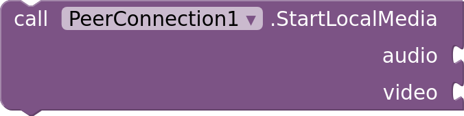
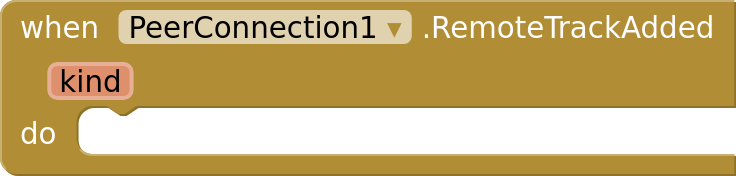
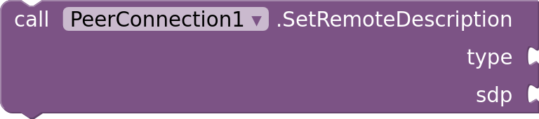
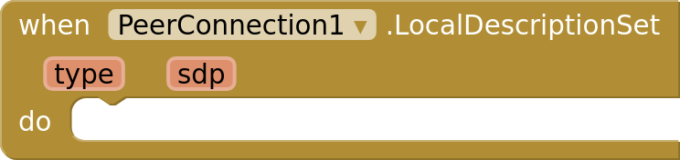
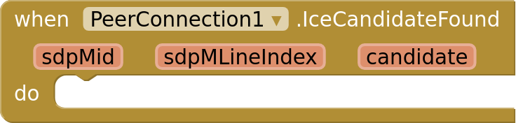
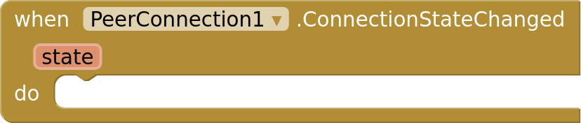
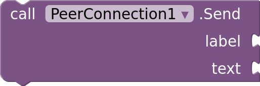
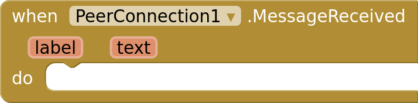
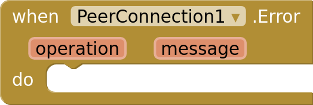

# Blocks

Every block of the WebRTC extension. A WebRTC call with another device: audio, video, and data channels for text messages. Send the descriptions and ICE candidates it produces to the other device through any channel, such as Supabase broadcast, and pass theirs back in. Each image contains its block, so you can drag it straight into your workspace.

- [Camera and microphone](#camera-and-microphone)
- [Video on screen](#video-on-screen)
- [Connecting](#connecting)
- [Data channels](#data-channels)
- [Errors](#errors)
- [Dropdowns](#dropdowns)

## Camera and microphone

**StartLocalMedia:** Starts the microphone, the camera or both, asking for permission first. LocalMediaStarted fires when they're ready: create the offer or answer after it so the other device receives them. If the user refuses, Screen.PermissionDenied fires.

**StopLocalMedia:** Stops the camera and microphone.

**LocalMediaStarted:** The microphone and camera asked for in StartLocalMedia are ready.

**SwitchCamera:** Switches between the front and back cameras. CameraSwitched fires when done.

**CameraSwitched:** The camera switched. Front is true when the front camera is now in use.

 

**MicrophoneEnabled** (read-write): Whether your microphone's audio is sent. When false, the other device hears silence.

 

**CameraEnabled** (read-write): Whether your camera's video is sent. When false, the other device sees black.

 

**Speakerphone** (read-write): Whether call audio plays through the loudspeaker. When false, it plays through the earpiece, or a connected headset.

 

**VideoWidth** (read-write): The camera's capture width in pixels for the next StartLocalMedia. The camera uses its closest size.

 

**VideoHeight** (read-write): The camera's capture height in pixels for the next StartLocalMedia.

 

**VideoFrameRate** (read-write): The camera's frames per second for the next StartLocalMedia.

## Video on screen

**ShowLocalVideo:** Shows your camera's video in an arrangement, filling it. Show it in the same arrangement as the remote video to get a small picture in the corner.

**ShowRemoteVideo:** Shows the other device's video in an arrangement, filling it.

**RemoteTrackAdded:** The other device's audio or video arrived. Kind is audio or video. Audio plays by itself; show video with ShowRemoteVideo.

 

**MirrorLocalVideo** (read-write): Whether your own video is shown mirrored while the front camera is in use. The other device always sees it unmirrored.

 

**VideoScaling** (read-write): How video fits its view: Fill crops the edges, Fit shows the whole picture.

## Connecting

**CreateOffer:** Starts a connection by creating an offer. LocalDescriptionSet fires with it: send it to the other device. Start local media and create data channels first.

**CreateAnswer:** Answers an offer passed to SetRemoteDescription. LocalDescriptionSet fires with the answer: send it back to the other device.

**SetRemoteDescription:** Applies the other device's offer or answer. Type is offer or answer.

**AddIceCandidate:** Adds an ICE candidate from the other device. Candidates that arrive before the other device's description are kept until it's set.

**LocalDescriptionSet:** Your offer or answer is ready. Send type and sdp to the other device, which passes them to SetRemoteDescription.

**IceCandidateFound:** A way to reach this device was found. Send all three values to the other device, which passes them to AddIceCandidate.

**ConnectionStateChanged:** The connection's state changed.

**ConnectionState** (read-only): The connection's state.

 

**IceServers** (read-write): The STUN and TURN servers used by the next connection: a list of dictionaries with urls (text or a list), and username and credential for TURN servers. Defaults to Google's public STUN server.

**Close:** Ends the connection. The other device's data channels close, and its connection state changes once it notices.

## Data channels

**CreateDataChannel:** Creates a data channel for text messages. Create it before CreateOffer; the other device gets it too, and DataChannelOpened fires on both when it's ready.

**Send:** Sends text over an open data channel.

**DataChannelOpened:** A data channel is ready to send and receive.

**DataChannelClosed:** A data channel closed.

**MessageReceived:** Text arrived on a data channel.

## Errors

**Error:** A block or the connection failed. Without this event, Screen.ErrorOccurred fires instead.

## Dropdowns

**ConnectionState:** New, Connecting, Connected, Disconnected, Failed, Closed

**VideoScaling:** Fill, Fit
