# The Video Call sample

`VideoCall.aia`, in every [release](https://github.com/zainulhassan815/webrtc-appinventor/releases/latest),
is a complete calling app: two people enter the same room name, tap **Join**, and see
each other. It uses a `PeerConnection` named `Call`, a `Supabase` component, and a
`SupabaseChannel` named `Signaling` to carry the call setup. Each image below contains
its blocks, so you can drag it into your own project.

## Joining a room

Each device picks a random id when the app starts, and uses it as its presence key on
the channel. `offered` remembers whether this device already started or answered a
call.

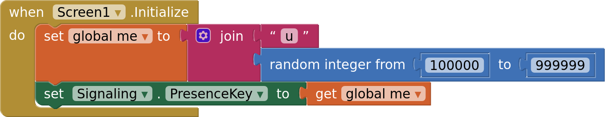

**Join** shows both videos in the same arrangement, so your own video becomes a small
picture in the corner, and starts the camera and microphone.

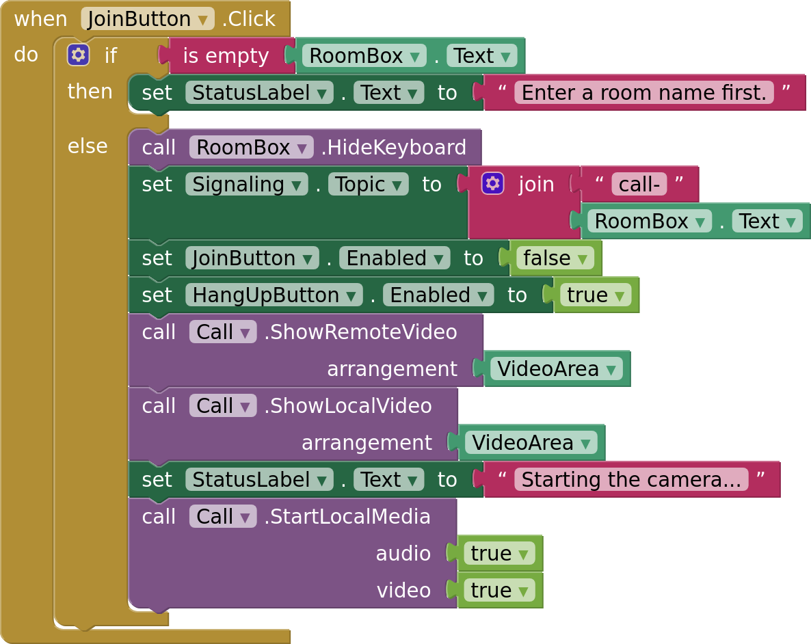

Once they're ready, the device listens for `signal` broadcasts and joins the channel.
When it's subscribed, it announces itself through presence.

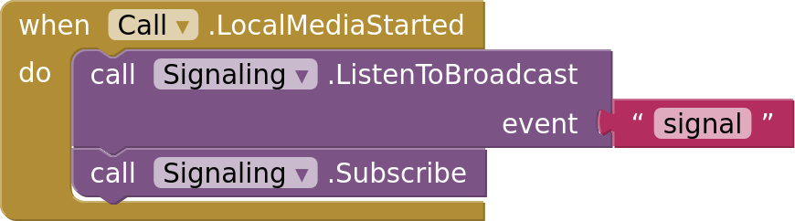

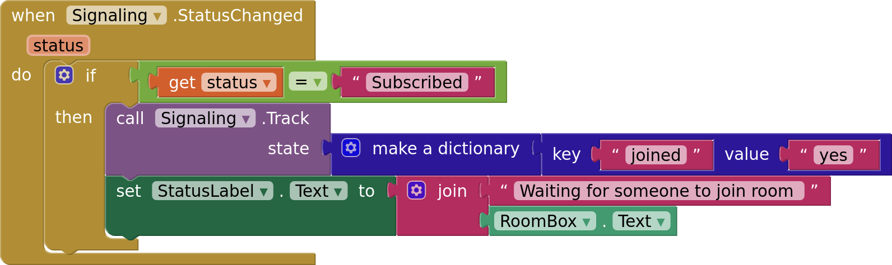

## Who calls whom

Both devices see each other in the channel's presence. Only the one with the smaller id
creates the offer, so the two never offer at the same time. When the other person
leaves, the call closes and the device waits for someone new.

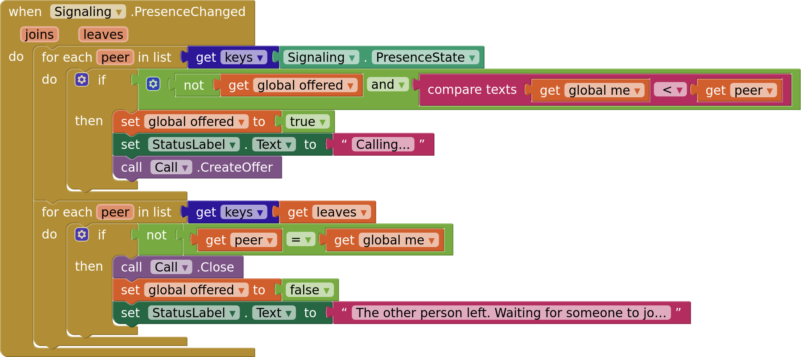

## Exchanging the call setup

Every description and ICE candidate the component produces goes out as a `signal`
broadcast, with this device's id:

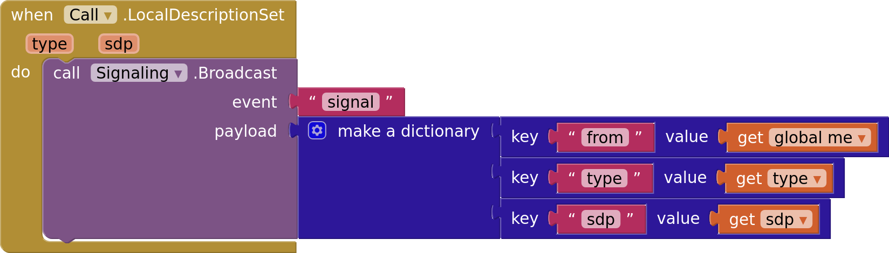

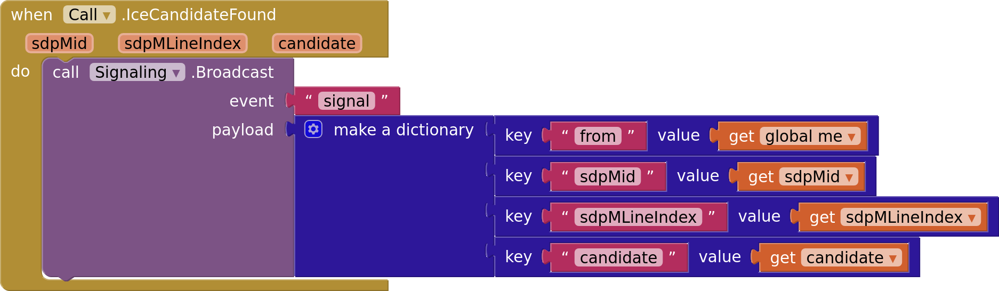

And every `signal` that arrives goes back into the component. An offer gets an answer;
`bye` means the other person hung up.

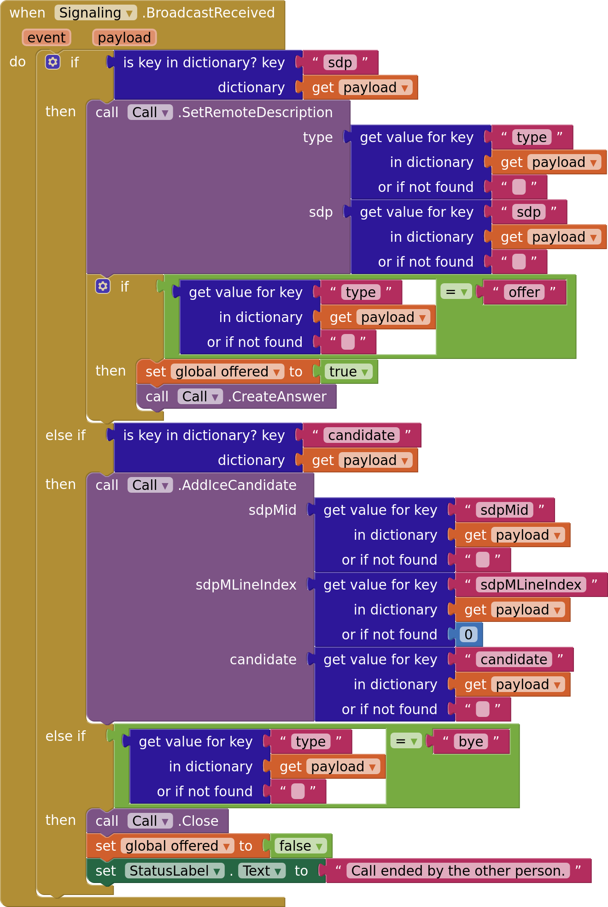

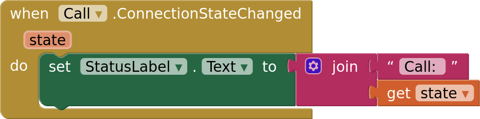

## Call controls

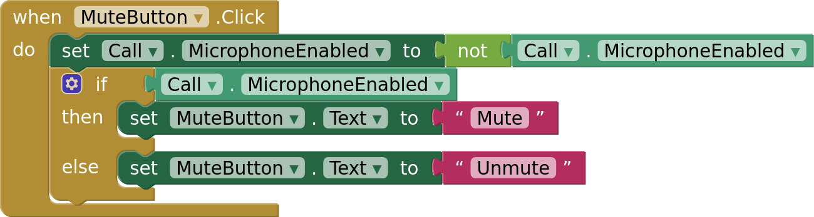

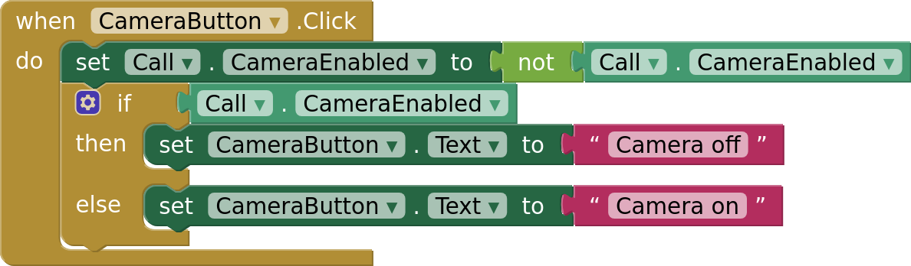

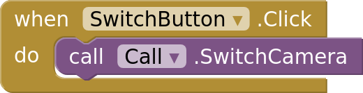

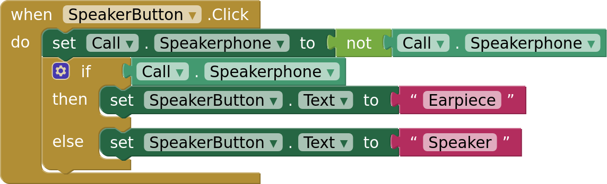

**Hang up** tells the other device, ends the call, stops the camera and leaves the
channel.

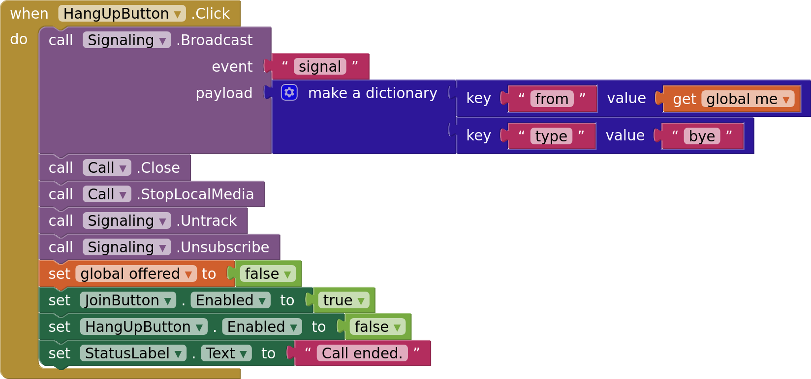

## Errors and permissions

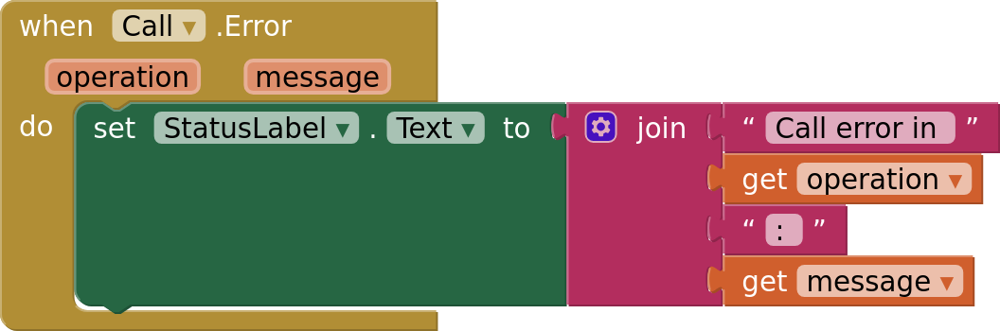

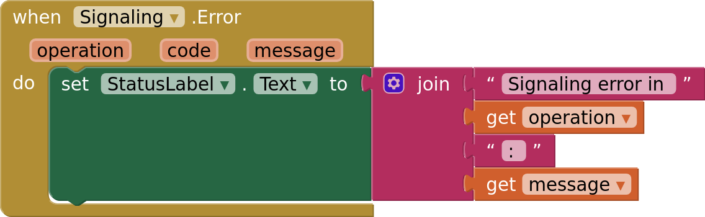

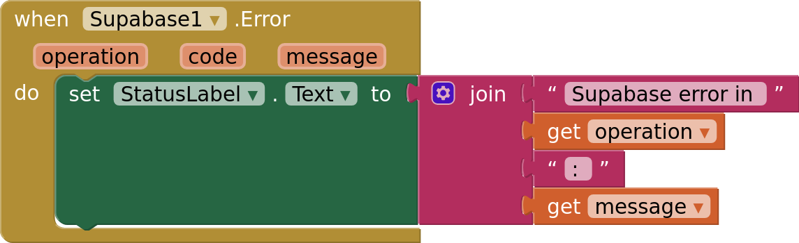

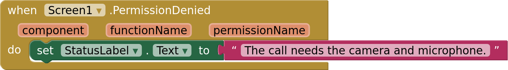
